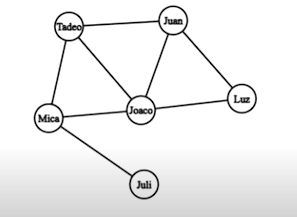
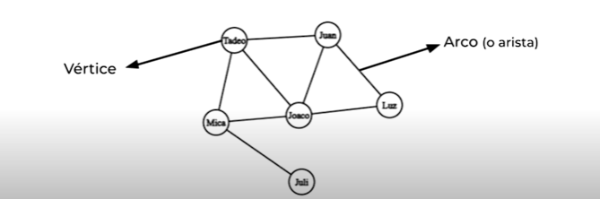
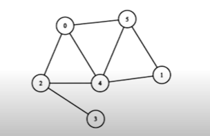
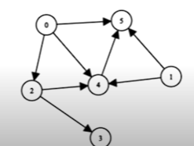
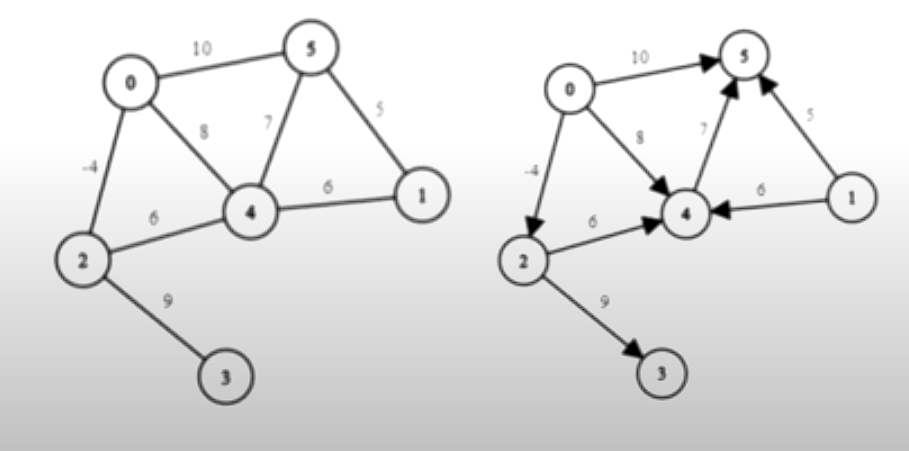
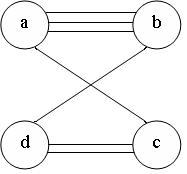
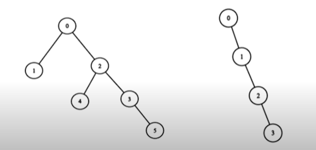
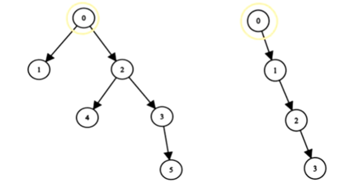
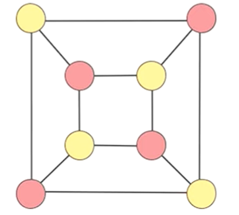
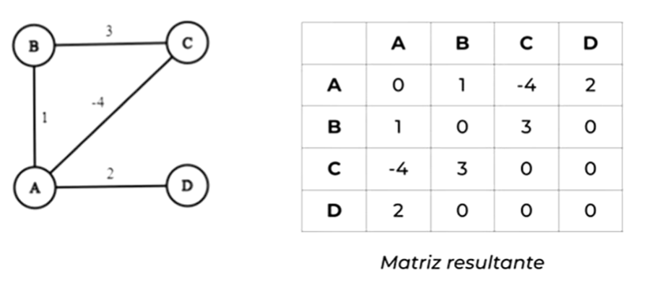

# Grafos
En las ciencias de la computacion la teoria de grafos busca representar y modelar relaciones entre conjuntos de datos con el objetivo de poder modelar un numero muy grande de problemas diversos

*Un ejemplo de esto* es la modelacion de una red social: 

En base a esta imagen podemos responder por ejemplo cuantos amigos directos tiene tadeo.
## Partes de un grafo

El grafo en su representacion grafica se compone por asi decirlo de bolitas y lineas las cuales son conocidas como: 

- **Nodos**: Los nodos son las "bolitas" o circulos que podemos encontrar en las representaciones graficas de estos, los nodos son los que contienen la informacion de estos mismos (matrices, vectores etc)

- **Arco**: Los arcos o aristas son las lineas o flechas que interconectan a estos nodos, los arcos pueden o no ser flecha dependiendo de si estos tienen direccion o no (entrando ya en dos tipos distintos de grafos *dirigidos* y *no dirigidos*)

## Tipos de Grafos

### Los mas comunes son: 

- **Grafo no dirigido** : es un grafo en el cual los arcos no tienen orientacion (se ve como una simple linea) es decir el arco (u,v) es identico al arco (v,u)

- **Grafo dirigido**: este tipo de grafo ya tiene orientacion o bien la orientacion ya influye (ya los arcos son flechas por asi decirlo) y en este caso el arco (u,v) es el arco que conecta al vertice u con el v por lo tanto (u,v) deja de ser igual a (v,u) por el sentido del arco

la representacion del grafo en su lista de adyaciencia es: A={(E,A),(b.c)}

- **Grafo con peso** : en este tipo de grafo los arcos pueden o no ser dirigidos pero estos tienen un peso espeficio que dependiendo del contexto del grafo puede representar muchas cosas, distancia entre los nodos etc.
Al valor asociado se le conoce como **coste**

- **Multi Grafo**: es aquel tipo de grafo que permite mas de una arista entre dos nodos (par de nodos)> (mientras que por lo general los regulares solo tienen una entre dos nodos)

### Grafos Especiales
- **Arboles**: los arboles son un tipo de grafo no dirigido sin ciclos (es decir no tienen redundancias entre si los nodos)

`por lo general cuando se habla de los arboles lo mas comun es que hablen de un arbol con raiz`
- **Arboles Binarios:** Son aquellos que en los que los nodos solo pueden tener 0, uno o dos hijos

- **Arbol Binario de Busqueda (ABB)** este tipo de arbol, solo puede tener entre 0-2 hijos, la curiosidad de este tipo de arboles es que los valores mayores van a la derecha y los menores van a la izquierda

- **Arbol AVL**: un arbol AVL es un tipo de arbol binario que se autobalancea para evitar una sobrecarga en alguna rama de este arbol `En este tipo de arbol existe algo llamado factor de Balanceo, el cual es un valor entre 1 y -1 que guardan sus nodos, esta cantidad significa distintas cosas si es 0 indica que ninguna rama esta cargada (esta equilibrado) si es -1 quiere decir que esta cargado hacia la derecha y si es +1 quiere decir que esta cargado hacia la izquierda `//verificar informacion
- **arboles con raiz**: los arboles con raiz son un tipo de grafo dirigido los cuales poseen  un vertice desde el cual se puede llegar al resto de los vertices del arbol 

- **Bipartitos** : Sus vertices pueden ser separados en dos grupos, permitiendo que cada vertice de un grupo se conecte con uno o mas vertices del otro grupo, la unica regla es la siguiente: `Dos vertices de un grupo no se conectan directamente`

- **Grafos No Bipartitos**: Son los grafos que comparten la regla de los bipartitos `Dos vertices de un grupo no se conectan directamente` la unica condicion por la que se les llama no bipartitos es porque tienen mas de dos grupos interactuando en el mismo grafo

## Representacion de Grafos

Para poder representar a los grafos cuando se quieran programar, se tiene que ver que tipo de estructura se usara y que opciones se tienen, las mas comunes son: 

- **Matriz de Adyaciencia** : Este tipo de matriz se construye como una tabla y las filas y columnas de la matriz representan los vertices del grafo y en cada una de las posiciones de la matriz va el peso que posee el arco que conecta a 2  determinados vertices 
cosas a considerar: 

    - `El peso de ir del vector X al vector X siempre va a ser 0 ya que no hay arco que conecte al vector X consigo mismo`
    - `Si no hay arco entre el nodo X y Z se considera que el peso es 0`
    
Este es un ejemplo de una matriz hecha a partir de un grafo 

para un grafo que no tiene peso se usa  0 para indicar que 2 vertices no son adyacentes, y uno para indicar que si lo son ademas cuando no son dirigidos, la matriz es simetrica, en cambio cuando son dirigidos la matriz no es simetrica

- **Lista de adyacencia:** la lista de adyacencia nos muestra cada uno de los nodos con su propia lista de nodos adyacentes 

- **Matriz de Incidencia:** en este tipo de matriz lo que enumeramos son a cantidad de arista, y la matriz cambia las filas son las aristas y las columnas son los nodos

- **Matriz poco densa** es la representacion de una matriz donde se elmina todo el desperdicio (es decir los 0 que aparecen)

- **Isomorfismo de grafos:** En ocasiones dos grafos con diferentes vertives presentan la misma estructura, se prueba buscando una funcion biyectiva () que convierta los vertices de uno en otro, preservando la estructura de las aristas
<!-- clase del 13 de noviembre-->

Es importante recordar que un mismo grafo puede tener diferentes representaciones graficas, es por eso que visualmente no sirve de mucho.

## Conceptos basicos
- **Adyacentes**: se dice que dos vertices son adyacentes si existe una arista que los une
- **Extremos:** los vertices que forman una arista son los extremos de la misma
- **Incidente:** si V es un extremo de una arista a se dice que es incidente con v
- **Grado:** el grado de un vertice v, gr(v) es el numero de arista incidentes en v. Si hace falta indicar el grafo en el que esta en v escribiremos gr(G,v).
- **Grado de un grafo:** es la suma de todos los grados de cada uno de sus vertices
- **Ciclo** un ciclo de grado n es aquel que inicia en donde acaba
-**Altura y Profundidad**: la altura es la manera en la que se cuenta como el arbol de va desplegando este empieza en nivel 0 (raiz), la profundidad es basicamente lo mismo pero este empieza en uno 

### Grafo Completo

Para cada n>=1 se llama grafo completo de orden n y se representa por Kn, al grafo de n vertivces conectados de todas las formas posibles, es decir cada nodo esta conectado a todos los demas nodos

Formula= (n(n-1))/2

## Teorema del apreton de manos

(Solo es aplicable en grafos "normales" en multigrafos no)

Sea G=(V,A) un grafo entonces: la suma de los grados de todos los vertices es igual a 2 veces el numero de aristas

