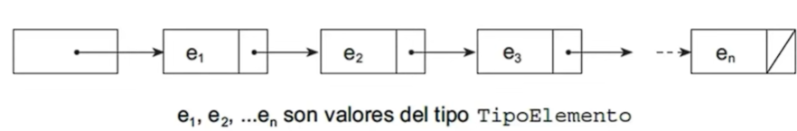
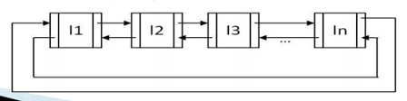

# Listas enlazadas

una lista enlazada consta de un numero de nodos (N) con dos componentes, cada nodo (llamados campos) un enlace al siguiente nodo de la lista y un valor del nodo que puede ser de cualquier tipo(int float etc)



## Componentes
Los componentes generales de una lista enlazada son: 

- **Nodo**: son los elementos que conforman a las listas y estan unidad mediante punteros
(son structs)

### Version general de un Struct para una lista enlazada

```C++
//dependiendo del tipo de lista se agregan mas elementos pero esto corresponde a una simple y base
typedef struct Nodo{
    int dato;
    Nodo *siguiente;
}Nodo;
```

## Tipos de listas enladas

### Lista  Simplemente enlazada

las estructura de este tipo de lista consiste en que cada nodo (elemento) contiene un unico enlace (puntero) que apunta solamente al siguiente elemento o nodo sucesor, este tipo de lista es eficiente al hacer recorridos directos (hacia adelante)


### Lista doblemente enlazada

las listas doblemente enlazadas consisten en que a diferencia de las listas simplemente enlazadas contiene dos enlaces (punteros) uno que al igual que las simplemente enlazadas apunta al elemento sucesor y el otro que apunta al elemento anterior a este mismo es decir al elemento predecesor, siendo eficiente para hacer recorridos tanto directos (adelante) como inversos (atras)


### Lista circular simplemente enlazada

Este tipo de lista es por asi decirlo exactamente igual que las simplemente enlazadas solo que con la particularidad que el ultimo elemento de esta lista a diferencia de no tener enlace, estas lo tienen y apuntan al primer elemento de la lista formando un "circulo" de tal modo que puede ser recorrida de modo circular


### Lista circular doblemente enlazada

En pocas palabras es una lista doblemente enlazada en donde el ultimo elemento se enlaza al primer elemento y visceversa, este tipo de lista se puede recorrer de modo circular tanto en direccion directa (hacia adelante) como inversa (hacia atras)




# Metodos recursivos
metodos recursivos para listas simples porque solo me sabia iterativa old school la picapiedra

```C++
//busqueda recursiva simple
bool buscarLista(Nodo *lista, int n){
    if (lista!=nullptr){
        if (lista->dato==n){
            return true;
        }else{
            buscarLista(lista->siguiente,n);//llamada recursiva al siguiente nodo
        }
    }else{
        return false;
    }
}

//insercion de nuevo elemento pero de manera recursiva
void insertarRecursivamente(Nodo *lista, int n){
    if (lista->siguiente==nullptr){
        lista->siguiente= new Nodo();//se genera e inserta un nuevo nodo al final
        lista->siguiente->dato=n;//asignamos valor
        lista->siguiente->siguiente=nullptr;//ponemos a nulo para saber que es el ultimo
    }else{
        insertarRecursivamente(lista->siguiente,n);//si no fue el final se llama a si misma pero checando ahora el siguiente nodo
    }
}
```


