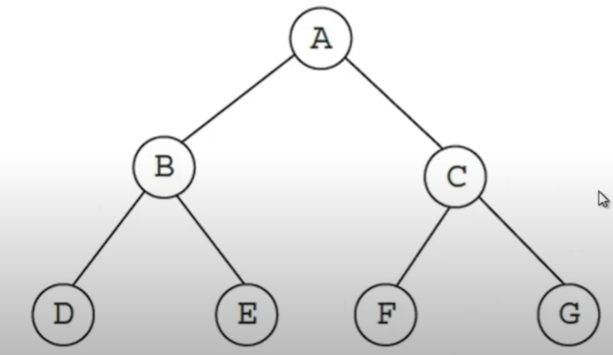
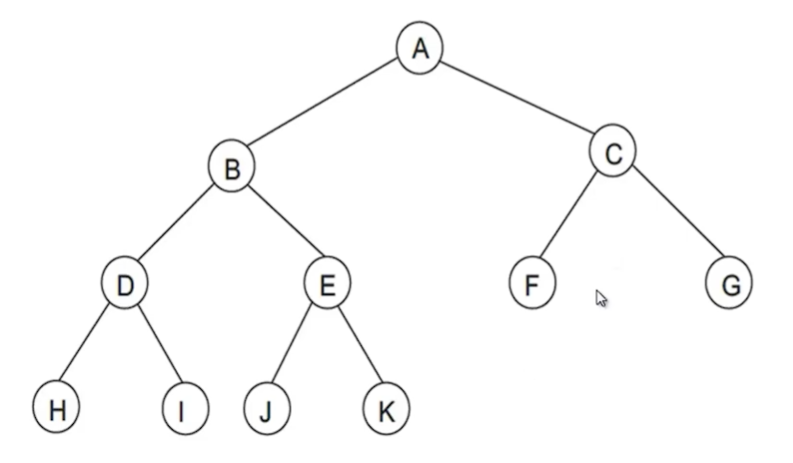
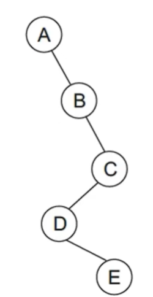

# Arboles Binarios

### Arbol binario
es un arbol de orden 2, es decir cada nodo puede tener entre 0-2 hijos 1 a la izquierda y 1 a la derecha `estructura recursiva`

```c++
//estructura general para el nodo de un arbol binario 
//(si pudiera tener mas hijos basta con agregar mas punteros pero ya no seria binario)
typedef struct Nodo{
    int dato;
    Nodo *izq;
    Nodo *der;
} Nodo;
    
```
`al nodo que no tiene hijos se le conoce como hojas`
### arbol lleno

es aquel que todos sus nodos tienen 2 hijos excepto el ultimo nivel y el ultimo nivel todos los nodos estan exactos



### arbol completo
es un como un arbol lleno con la excepcion de que su ultimo nivel no esta completo (no todas las hojas llegan al mismo nivel) y por lo general el lado izquierdo casi siempre hay mas nodos que en lado derecho


### arbol degenerado
solo tiene hijos por un lado siendo practicamente una lista enlazada



### Arbol binario de busqueda (ABB)
es aquel que dado un nodo, todos los datos del subarbol izquierdo son menores, mientras que todos los datos del subarbol derecho son mayores